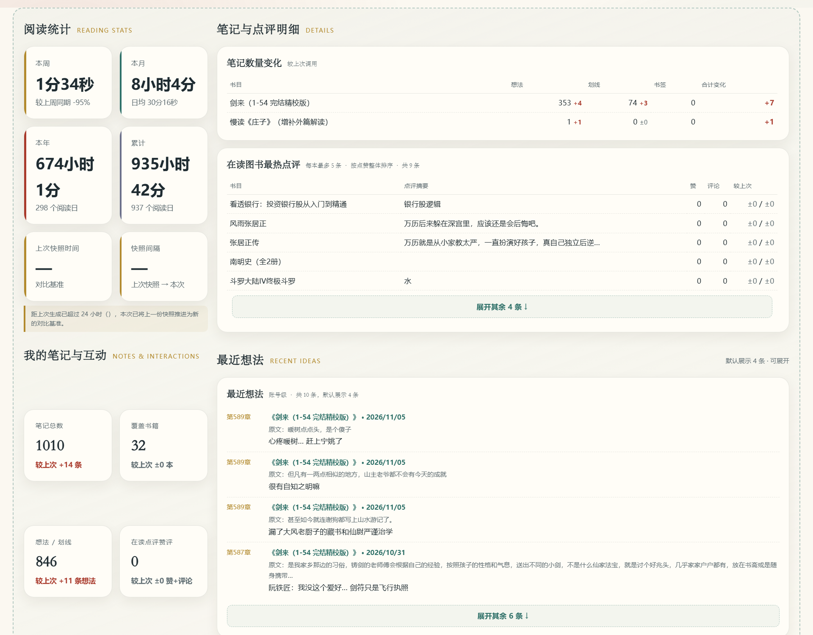
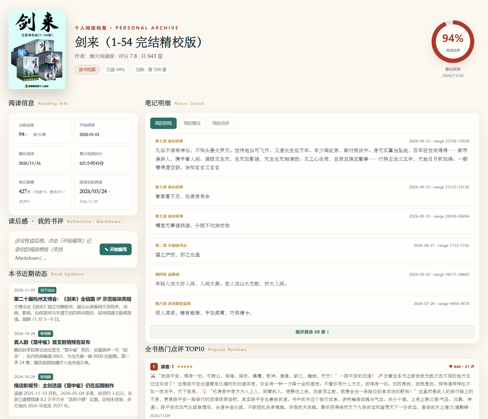

# 微信读书小书童（weread-reading-buddy）

这是一个完整的微信读书技能：既能回答书籍搜索、书架、阅读统计、笔记划线、热门划线、书籍点评、好书推荐等日常查询，又能把账号数据整理成可读、可分享的视觉化页面 —— **个人阅读报告** 与 **每本书的独立读书档案**。

当前版本：**V0.5.3**


 


## 效果预览（脱敏样例数据）

以下截图来自随技能分发的脱敏样例（`data/bundle_sample.json`），好友名为 `好友-N`、评论作者为 `评论者-N`、点评作者为 `读者-N`，不含任何真实个人信息或密钥。

**报告全局区** — 阅读统计、笔记互动、最近想法三栏联动：



**书架与随书区** — 书架卡片切换联动封面、进度、热门划线 TOP10 与热评：


**读书档案（剑来）** — 阅读信息、笔记明细、读后感编辑器、全书热门点评：



## 能力一览

**基础查询**（对话式，基于微信读书的接口真实数据）

- 搜索书籍并解析 bookId、查看书籍详情/章节目录/阅读进度
- 查看书架（电子书 + 专辑/有声书计数）、阅读概况、阅读时长/天数/偏好统计
- 导出个人笔记、划线、想法、书签数量
- 查看章节热门划线与划线下想法、书籍公开点评
- 个性化推荐与相似书推荐

**增强输出**（可视化页面）

- 阅读报告用本地快照对比"上次 → 本次"的变化，不伪造历史轨迹；保留两份最近快照，距上次不足 24 小时只滚动更新最新快照、对比基准不变
- 账号级统计、笔记互动、好友在读（真实姓名）、最近想法
- 在读图书最热点评
- 书架按「快照区间优先」选书，展示本人在读书目
- 好友在读固定 5 位（按最近互动排序），并展示好友在读书目
- 为自己读的每本书建立一份独立档案，包括基础阅读书籍，并汇总个人的想法、划线、点评，可以编辑读后感保存，也能查看关于该书的最近网络动态
- 建议使用Skill时，用定时任务每周生成一次阅读报告，持续跟踪自己的阅读变化

## 30 秒体验（无需密钥）

```bash
python scripts/render.py all data/bundle_sample.json demo/
```

打开 `demo/我的阅读报告_YYYYMMDD.html`，点击书架卡片切换书目，点击"打开完整档案 →"。样例数据均已脱敏。

## 真实数据运行

在用户已设置本地连接API_KEY（下方说明）之后，然后：

```bash
# 先联网检索每本在读书的真实近期动态，写入 data/news/<bookId>.json（没有就留空）
python scripts/collect.py --out data/bundle.json
python scripts/render.py all data/bundle.json output/WeReadBuddy
```

产物结构（统一在 `output/WeReadBuddy/`）：
```
WeReadBuddy/
├── 我的阅读报告_YYYYMMDD.html        ← 按日期命名，可保留多份
├── 读书档案/
│   └── 书本名称_读书档案.html         ← 每本一份，按书名命名，存在即更新
└── 报告及档案更新记录.md              ← 每次内容变更追加一条
```

- `collect.py` 默认 `--books 10`（按快照区间优先口径选书，详见上）；可选 `--highlights 10 --reviews 10 --friends 5 --snapshot <path> --prev-snapshot <path>`。快照保留最新 `data/snapshots/last_call.json` 与基准 `data/snapshots/prev_call.json` 两份。
- `render.py all` 只需一个根目录参数；可选 `--archive-dir <dir>` 覆盖档案目录、`--log <file>` 覆盖更新记录路径。
- `data/news/<bookId>.json` 放该书近期动态数组（元素含 `date/cat/title/summary/source/url`）；每次生成都应重新检索同步，没有就留空，页面如实显示"暂无"，不编造资讯。

## API Key 指引

首次使用需要从微信读书的官方页面(https://weread.qq.com/r/weread-skills)下获取API KEY，并在本地进行配置（本SKill不保存，不记录）

密钥建议**自行在本地设置为环境变量**，不要在聊天里发送：

- macOS / Linux：`export WEREAD_API_KEY="wrk-你的密钥"`
- Windows PowerShell（临时）：`$env:WEREAD_API_KEY="wrk-你的密钥"`
- Windows PowerShell（用户级持久化）：`[Environment]::SetEnvironmentVariable('WEREAD_API_KEY','wrk-你的密钥','User')`

密钥只在运行时从环境变量读取：**不写入任何项目文件、不打印、不进入生成页面或数据快照，也不应出现在对话记录中**。格式 `wrk-...`，绑定你的微信读书账号身份。

## 测试

```bash
python -m unittest discover -s tests -v
```

## 隐私与脱敏

- 生成的 HTML 含个人阅读数据，分享前请自行检查。
- 随技能分发的样例及截图已脱敏：好友名为"好友-N"、好友 ID 为"FRIEND-N"、点评作者为"读者-N"、热门划线评论作者为"评论者-N"、reviewId 前缀为"FAKE-N"假 ID；`prepare_assets.py` 内置全部脱敏，重跑抽取不会回流真实信息。
- 读后感仅存浏览器 localStorage，导出/导入 JSON 由用户自行保管。


## 设计取舍

接口给的是快照和聚合值，本技能用**本地快照差值**还原"最近一次调用以来的变化"，不伪造逐次阅读轨迹。更多边界见 `SKILL.md` 的"已知边界"。
