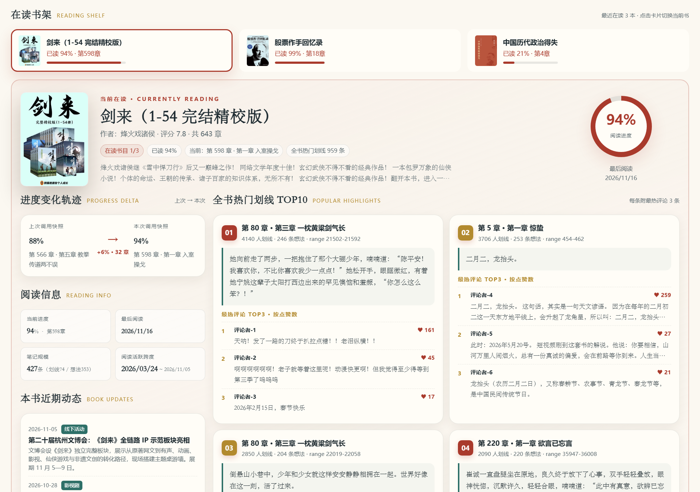

# 微信读书小书童（weread-reading-buddy）

一个完整的微信读书技能：既能回答书籍搜索、书架、阅读统计、笔记划线、热门划线、书籍点评、好书推荐等日常查询，又能把账号数据整理成两份可读、可分享的视觉化页面 —— **个人阅读报告** 与 **每本书的独立读书档案**。

当前版本：**V0.5.2** · 目标：公开技能，供他人调用。

## 图标候选（发布用，三选一）

均为 1024×1024 方形 PNG，无文字、无敏感视觉，选定一张作为 SkillHub 头像即可（未设置图标时平台用默认占位图）。

| 候选 | 预览 | 风格 |
| --- | --- | --- |
| 1 · 翻开书 + 进度弧 |  | 米黄纸底 + 朱红，编辑感 |
| 2 · 书堆 + 进度环 |  | 墨蓝灰 + 朱红，现代极简 |
| 3 · 书生猫头鹰 |  | 暖色扁平，亲和吉祥物 |

## 效果预览（脱敏样例数据）

以下截图来自随技能分发的脱敏样例（`data/bundle_sample.json`），好友名为 `好友-N`、评论作者为 `评论者-N`、点评作者为 `读者-N`，不含任何真实个人信息或密钥。

**报告全局区** — 阅读统计、笔记互动、最近想法三栏联动：


**书架与随书区** — 书架卡片切换联动封面、进度、热门划线 TOP10 与热评：



**读书档案（剑来）** — 阅读信息、笔记明细、读后感编辑器、全书热门点评：


## 能力一览

**基础查询**（对话式，基于 Gateway 真实数据）

- 搜索书籍并解析 bookId、查看书籍详情/章节目录/阅读进度
- 查看书架（电子书 + 专辑/有声书计数）、阅读概况、阅读时长/天数/偏好统计
- 导出个人笔记、划线、想法、书签数量
- 查看章节热门划线与划线下想法、书籍公开点评
- 个性化推荐与相似书推荐

**增强输出**（可视化页面）

- 阅读报告用本地快照对比"上次 → 本次"的变化，不伪造历史轨迹；保留两份最近快照，距上次不足 24 小时只滚动更新最新快照、对比基准不变，统计区显示小字说明，避免短间隔导致差值恒为 0
- 阅读统计新增"上次快照时间""快照间隔"两栏；顶部导航锚点校正
- 账号级统计、笔记互动、好友在读（真实姓名）、最近想法（书名 + 章节 + 原文/正文各 80 字截断）
- 在读图书最热点评（每本最多 5 条、按点赞整体排序），标签不再误称"本人点评互动"
- 书架按「快照区间优先」选书：首次取最近 10 本在读，此后优先两次快照之间有阅读记录的书（最多 10 本，不足 3 本从最近在读补足）。卡片切换联动封面/进度/阅读信息/本书动态/热门划线 TOP10
- 好友在读固定 5 位（按最近互动排序），每位好友的书目沿用同一「快照区间优先」口径：区间内有互动的书优先、最多 10 本、不足 3 本从最近补足；不再因区间内无互动好友而缩减人数
- 每本书一份独立档案：开始阅读时间、累计时长、读后感 Markdown 弹窗（自动保存/导出/导入）、笔记明细（划线/想法/点评）、热门点评 TOP10
- 所有产物统一到一个根目录 `WeReadBuddy/`：多份 `我的阅读报告_YYYYMMDD.html`、`读书档案/<书本名称>_读书档案.html`、`报告及档案更新记录.md`
- 档案按书名命名（非法字符替换、重名加 bookId 后缀），每次生成新增或覆盖更新
- 报告全局区三栏等高，左栏"阅读统计""我的笔记与互动"拉伸填满、底部与"最近想法"对齐；明细长列表固定高度 + 默认折叠，数据增多也不撑开排版
- 长列表默认折叠、点击展开，首屏和谐
- 建议用定时任务每周生成一次报告，持续跟踪阅读变化

## 30 秒体验（无需密钥）

```bash
python scripts/render.py all data/bundle_sample.json demo/
```

打开 `demo/我的阅读报告_YYYYMMDD.html`，点击书架卡片切换书目，点击"打开完整档案 →"。样例数据均已脱敏。

## 真实数据运行

由用户自行设置密钥（见下方说明），然后：

```bash
# 先联网检索每本在读书的真实近期动态，写入 data/news/<bookId>.json（没有就留空）
python scripts/collect.py --out data/bundle.json
python scripts/render.py all data/bundle.json output/WeReadBuddy
```

产物结构（统一在 `output/WeReadBuddy/`）：
```
WeReadBuddy/
├── 我的阅读报告_YYYYMMDD.html        ← 按日期命名，可保留多份
├── 读书档案/
│   └── 书本名称_读书档案.html         ← 每本一份，按书名命名，存在即更新
└── 报告及档案更新记录.md              ← 每次内容变更追加一条
```

- `collect.py` 默认 `--books 10`（按快照区间优先口径选书，详见上）；可选 `--highlights 10 --reviews 10 --friends 5 --snapshot <path> --prev-snapshot <path>`。快照保留最新 `data/snapshots/last_call.json` 与基准 `data/snapshots/prev_call.json` 两份。
- `render.py all` 只需一个根目录参数；可选 `--archive-dir <dir>` 覆盖档案目录、`--log <file>` 覆盖更新记录路径。
- `data/news/<bookId>.json` 放该书近期动态数组（元素含 `date/cat/title/summary/source/url`）；每次生成都应重新检索同步，没有就留空，页面如实显示"暂无"，不编造资讯。

## API Key 指引

密钥请**自行在本地设置为环境变量**，不要在聊天里发送：

- macOS / Linux：`export WEREAD_API_KEY="wrk-你的密钥"`
- Windows PowerShell（临时）：`$env:WEREAD_API_KEY="wrk-你的密钥"`
- Windows PowerShell（用户级持久化）：`[Environment]::SetEnvironmentVariable('WEREAD_API_KEY','wrk-你的密钥','User')`

密钥只在运行时从环境变量读取：**不写入任何项目文件、不打印、不进入生成页面或数据快照，也不应出现在对话记录中**。格式 `wrk-...`，绑定你的微信读书账号身份。

## 测试

```bash
python -m unittest discover -s tests -v
```

## 隐私与脱敏

- 生成的 HTML 含个人阅读数据，分享前请自行检查。
- 随技能分发的样例及截图已脱敏：好友名为"好友-N"、好友 ID 为"FRIEND-N"、点评作者为"读者-N"、热门划线评论作者为"评论者-N"、reviewId 前缀为"FAKE-N"假 ID；`prepare_assets.py` 内置全部脱敏，重跑抽取不会回流真实信息。
- 读后感仅存浏览器 localStorage，导出/导入 JSON 由用户自行保管。

## 发布前检查清单

- [ ] 用真实 API Key 跑通 `collect.py` + `render.py all`。
- [ ] 检查生成页不含密钥、不含他人隐私数据。
- [ ] 确认 README 与 SKILL.md 的示例路径在全新环境可用。
- [ ] 更新 CHANGELOG 与 VERSION，打 Git tag。
- [ ] 确认样例数据已脱敏。

## 设计取舍

接口给的是快照和聚合值，本技能用**本地快照差值**还原"最近一次调用以来的变化"，不伪造逐次阅读轨迹。更多边界见 `SKILL.md` 的"已知边界"。
